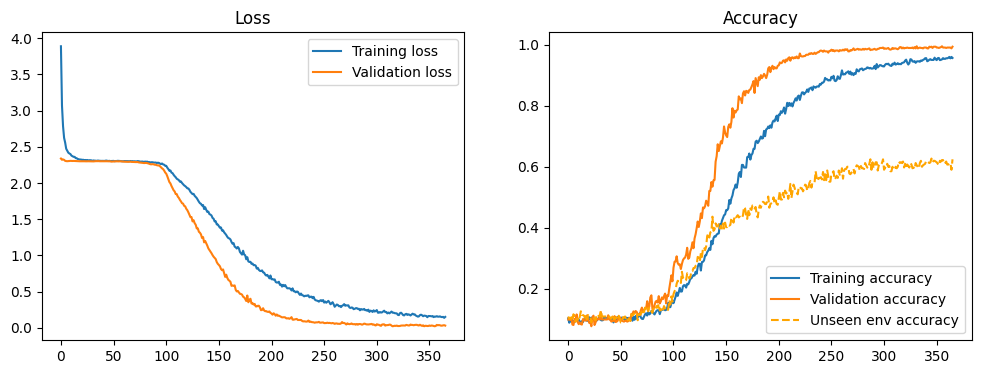
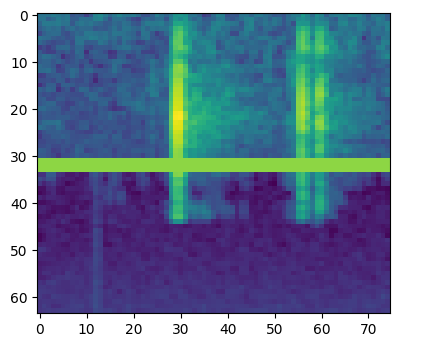

# Keyboard Sound — Acoustic Keystroke Detection

Minor project on recognising which key was pressed from the **sound** it makes. The
repository contains the full data-collection pipeline, the recorded keystroke
dataset, CNN/CoAtNet training notebooks, trained model checkpoints, and desktop
and web interfaces for live prediction.



## Overview

Keyboard keys produce distinct acoustic signatures. This project records those
sounds, segments each keystroke, converts it to a mel spectrogram, and classifies
it with a convolutional neural network.

- **Task**: 36-class classification (digits `0-9` and letters `a-z`)
- **Input**: log mel spectrogram of a single keystroke
- **Model**: 4-block CNN (64 → 128 → 256 → 512 channels) with a fully connected head;
  a CoAtNet-1 implementation is also included
- **Interfaces**: Gradio web app and Tkinter desktop UI, both supporting live
  microphone input and file upload
- **Data tooling**: Tkinter data pipeline for continuous recording, segmentation,
  merging, cleanup, and analysis

## Repository structure

```
.
├── CNN.ipynb                     # Main training pipeline
├── CNN-HyperparamTuning.ipynb    # Optuna search over mel-spectrogram parameters
├── CNN-FineTuning.ipynb          # Fine-tune a trained model on production data
├── CNN-ShuffleTest.ipynb         # Label-permutation sanity check
├── CNN-StressTest.ipynb          # Noise / SNR stress testing
├── gradcam_analysis.ipynb        # Grad-CAM interpretability
├── data_integrity_analysis.ipynb # Dataset integrity analysis
├── cnn_shared.py                 # Shared dataset, augmentation and CNN classes
├── data-pipeline.py              # Entry point for the recording/segmentation GUI
├── data_pipeline/                # Pipeline modules (collector, segmenter, merger, ...)
├── inference/
│   ├── app_gradio.py             # Gradio web interface
│   └── keystroke_detector_ui.py  # Tkinter real-time detection UI
├── model/
│   ├── *_AULA-ALPHANUM*.pkl      # Trained CNN checkpoints
│   ├── model_architecture.py     # CoAtNet implementation
│   ├── audio_processor.py        # Segmentation + spectrogram preprocessing
│   ├── recorder.py               # Microphone capture
│   └── Noises/                   # Ambient noise library used for augmentation
├── Data/                         # Recorded keystroke audio (~6.5 GB)
├── images/                       # Figures used in reports/docs
├── docs/                         # UI and augmentation guides
├── study/                        # Literature review and project documents
├── requirements.txt              # Full environment (Windows/Linux)
├── requirements_wsl.txt          # WSL environment
├── requirements_colab.txt        # Minimal Google Colab environment
└── recording_config.json         # Active mic / keyboard / device settings
```

## Dataset

All audio is stored under `Data/`:

| Path | Contents |
|------|----------|
| `Data/segmented/<keyboard>/<session>/<label>/*.wav` | One file per segmented keystroke |
| `Data/un-segmented/<keyboard>/<session>/continuous/<label>/audio.wav` | Continuous recordings per key |
| `Data/small-bulk-test/` | Small mixed test recordings |

Sessions cover several keyboards, microphones (including a DJI mic), and recording
positions/environments, e.g. `alpha-large`, `alphanum-400`, `num-150`,
`AULA`, `AULA-STARVECTOR`, and `kumara` sessions. Labels are directory names
(`a`–`z`, `0`–`9`).

`model/Noises/` holds 36 ambient noise samples in four categories — `city`,
`classroom`, `office`, and `Common Noises` — used for noise-robust augmentation.

> The dataset is roughly 6.5 GB across ~48k files, so the initial clone is large.

## Setup

Python 3.10+ is recommended.

```bash
git clone https://github.com/divaspoudel0/minor-project.git
cd minor-project

python -m venv .venv
# Windows
.venv\Scripts\activate
# Linux / macOS
source .venv/bin/activate

pip install -r requirements.txt
```

For WSL use `requirements_wsl.txt`; for a minimal Colab setup use
`requirements_colab.txt`. Install a CUDA build of PyTorch if a compatible GPU is
available.

## Usage

### Data collection and segmentation

```bash
python data-pipeline.py
```

or run `data-pipeline.bat` on Windows (it expects a `venv` directory). The GUI
provides tabs for recording, segmentation, dataset merging, cleanup, and audio
analysis. Device and session settings live in `recording_config.json`:

```json
{
    "mic_id": "dji",
    "keyboard_id": "aula-master1",
    "input_device": 2,
    "output_device": 4,
    "sample_rate": 44100
}
```

### Gradio web interface

```bash
python inference/app_gradio.py --model model/CNN-Final-AULA-ALPHANUM.pkl
```

Add `--share` for a temporary public URL, or `--port <port>` to change the port.
On Windows you can also run `launch-gradio.bat`.

### Desktop detection UI

```bash
python inference/keystroke_detector_ui.py
```

The UI streams microphone audio, detects keystrokes by energy, and shows the top-5
predictions with confidence. On Windows, `keystoke-detectior.bat` launches it.

> Some `.bat` helpers reference an older `model/CNN-Final.pkl` name or a different
> virtualenv folder (`venv` vs `.venv`). Pass an explicit model path / activate the
> matching environment if a launcher cannot find them.

## Training

The notebooks are designed for Google Colab or a local GPU machine and load data
from `Data/` plus `model/Noises/`. Shared code lives in `cnn_shared.py`.

| Notebook | Purpose |
|----------|---------|
| `CNN.ipynb` | Train the baseline CNN with augmentation |
| `CNN-HyperparamTuning.ipynb` | Optuna search over mel-spectrogram parameters, maximising unseen-environment accuracy |
| `CNN-FineTuning.ipynb` | Fine-tune a trained checkpoint on production recordings |
| `CNN-ShuffleTest.ipynb` | Permute labels and confirm accuracy collapses to chance (~1/36) |
| `CNN-StressTest.ipynb` | Evaluate under multiple noise types and SNR levels |
| `gradcam_analysis.ipynb` | Visualise model attention with Grad-CAM |
| `data_integrity_analysis.ipynb` | Audit the dataset for duplicates and artefacts |

### Preprocessing and augmentation

Each waveform is converted with `torchaudio` to a log mel spectrogram. The
best recorded search configuration was:

| Parameter | Value |
|-----------|-------|
| `n_mels` | 64 |
| `hop_length` | 256 |
| `n_fft` | 2048 |
| `win_length` | 1024 |
| `f_min` | 298.97 Hz |
| `f_max` | 19569.78 Hz |
| `power` | 1.0 (magnitude, log2 scale) |

Training applies hybrid noise augmentation (real ambient noise, white noise, and
Gaussian noise at 5–20 dB SNR), random volume reduction, time shifting, and
frequency/time masking. The recorded mel-spectrogram search reached a best
unseen-environment accuracy of **0.6220**.



## Models

Trained checkpoints are stored in `model/` (~19 MB each) and follow the
`CNN-*-AULA-ALPHANUM*.pkl` naming pattern, including the base model, lab and
production fine-tunes, and their `FT-best` / `FT-final` variants. The inference
apps load these checkpoints and can also be pointed at a custom path with
`--model`.

## Documentation

- `docs/GRADIO_APP_GUIDE.md` — web app features, recording tips, sharing
- `docs/README_UI.md` — desktop UI and preprocessing details
- `docs/NOISE_AUGMENTATION_SUMMARY.md` — augmentation design and probabilities
- `docs/NOISE_AUGMENTATION_QUICK_REFERENCE.md` — tuning reference
- `data_pipeline/docs/` — pipeline user guides (merging, batch processing)
- `study/papers/Literature_Review_ASCA.md` — acoustic side-channel literature review

## Notes

- The inference and pipeline applications are Windows-first; Linux users should
  run the Python entry points directly.
- Model files and audio data are tracked directly in Git (no Git LFS), which is why
  the repository is large.
- This project is intended for academic research and coursework.
